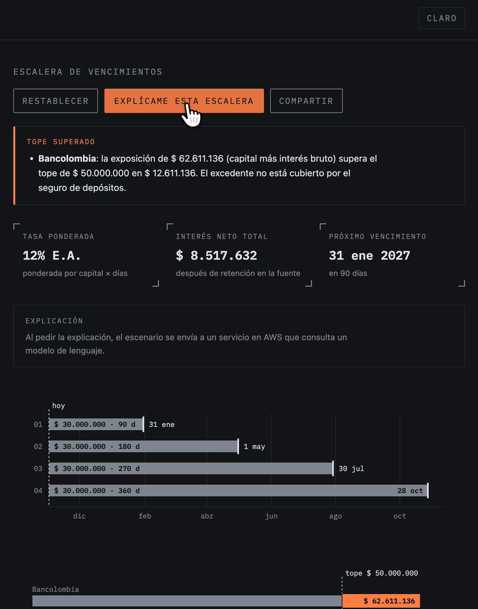

# lab / cdt-ladder

A visual calculator for CDT laddering (Colombian term deposits): stagger
maturities across rungs, project interest after withholding tax, and keep an
eye on the deposit-insurance ceiling — React 18 + TypeScript, unit-tested,
deployed by CI.

**Live demo:** <https://estebancitox.github.io/lab-cdt-ladder/>

<!-- GIF placeholder — record with:
     1. `npm run dev`, browser at 1280×800, light theme.
     2. Type a capital, change rung count and spacing, watch the ladder and
        table recalculate live; toggle the theme at the end.
     3. Capture ~12 s with Kap or QuickTime, export as demo.gif (≤ 3 MB),
        commit at repo root and replace this comment with:
        
-->

## Why this one has a toolchain

The [portfolio](https://estebancitox.github.io/) and
[lab-instrument](https://github.com/estebancitox/lab-instrument) are
deliberately zero-build: a static page earns no toolchain. This project is the
counterargument from the other side — an interactive calculator with financial
math worth testing *does* earn one, so it uses the daily production stack:
Vite, React 18, TypeScript, Vitest, GitHub Actions. Knowing which projects
deserve which toolchain is the point.

## How the engine works

A pure TypeScript module (`src/engine/`, no React imports) does all the money
math. Effective annual rates convert to period interest as
`(1 + EA)^(days/base) − 1`, where the liquidation base is selectable: **360
"comercial"** — the convention Colombian CDT certificates state as "Base
liquidación", and the default — or 365. Calendar maturities always count real
days; only the exponent changes. Gross interest rounds to whole COP per rung
as a cash event; withholding (retención en la fuente) is computed on that
rounded gross so every table row reconciles by hand; the blended rate is the
principal×days-weighted average of rung rates. The suite includes
reproduction fixtures against real-world comercial-base figures. Dates are
date-only ISO strings with calendar-day arithmetic — no `Date` millisecond
math, so results are identical in any timezone. The test suite runs twice in
CI (`TZ=America/Bogota` and `TZ=UTC`) to prove it.

## Fiscal parameters are inputs, not facts

Fiscal figures change by decree, so the tool never hardcodes them as current
truth and never claims live market rates. The withholding rate (retención en
la fuente) is an editable field labeled "verifica la tarifa vigente"; the
deposit-insurance ceiling becomes an editable field with the multi-entity
milestone (M2). A visible disclaimer says all of this in the UI. It is a
modeling tool, not financial advice.

## Tests gate the deploy

CI runs install → test → build → deploy with the official
`actions/deploy-pages` flow. The deploy job depends on the build job, and
tests run before the build step inside it: a red test means nothing ships.
No badge — the pipeline is the statement.

## Controls

| Input | Effect |
| --- | --- |
| `Capital total` | Total COP, split near-equally across rungs (the sum is always exact) |
| `Número de peldaños` | How many CDTs the ladder holds (1–12) |
| `Espaciado entre vencimientos` | Days between one maturity and the next; rung *n* matures at *n* × spacing |
| `Tasa E.A.` | Effective annual rate applied to every rung — user-supplied, never fetched |
| `Base de liquidación` | Exponent base for the rate conversion: 360 comercial (the CDT-certificate convention, default) or 365 |
| `Fecha de inicio` | Purchase date; maturities and the today line follow it |
| `Retención en la fuente` | Withholding on interest, editable — check the current tariff |
| `claro / oscuro` | Theme toggle; the instrument plate stays dark in both |
